# EduCenter — نظام إدارة مركز تعليمي

مشروع تخرج. موقع لمركز تعليمي فيه ثلاث أنواع مستخدمين:

- **الطالب:** بيتصفّح الكورسات وبيسجّل فيها، وبيتابع دروسه، وبيسلّم الواجبات، وبيشوف حضوره وعلاماته وجدوله الأسبوعي، وبتوصله إشعارات. بيسأل بنقاش الكورس، وبيسجّل حضوره بمسح QR، ولما يخلّص الكورس بياخد شهادة.
- **المدرّس:** بينزّل الدروس، وبيحدد مواعيد الكورس، وبيسجّل الحضور بإيده أو بالـ QR، وبيعمل واجبات وبيصححها، وبيرد على أسئلة الطلاب.
- **الإدارة:** بتدير الأقسام والكورسات والمدرّسين والفعاليات والأخبار والمستخدمين والصلاحيات، وبتقرأ رسائل التواصل، وبتشوف التقارير.

الموقع بالعربي والإنجليزي، وفيه وضع ليلي، وبيشتغل على الموبايل.

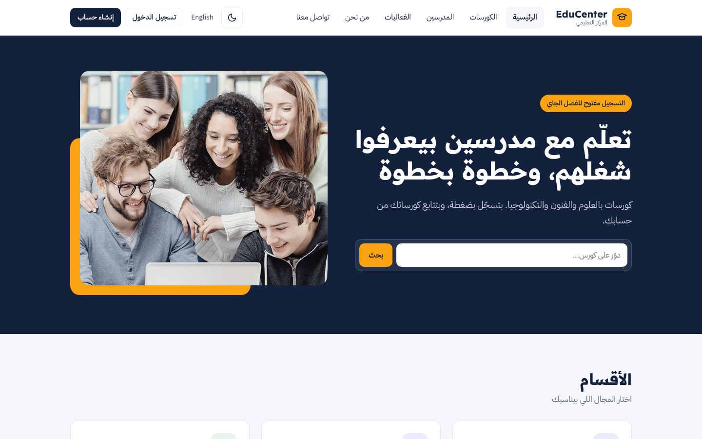

## التقنيات

- Laravel 12 و PHP 8.2 أو أحدث
- MySQL، أو SQLite للتجربة السريعة
- Blade و CSS عادي. الألوان والمسافات معرّفة كمتغيرات بملف `public/css/tokens.css`
- `mcamara/laravel-localization` للغتين بلوحة التحكم
- API بسيط للقراءة بس، بيرجّع JSON
- `chillerlan/php-qrcode` لرسم رموز الـ QR (الشهادة والحضور)

## التشغيل

```bash
git clone <repo-url> educenter
cd educenter
composer install
cp .env.example .env
php artisan key:generate
```

عدّل إعدادات قاعدة البيانات بملف `.env`، وبعدها:

```bash
php artisan migrate --seed
php artisan serve
```

وافتح `http://127.0.0.1:8000`.

### الإشعارات والتذكيرات

- الإشعارات بتنبعت عن طريق الـ Queue. للتجربة خلّي `QUEUE_CONNECTION=sync` و`MAIL_MAILER=log`، فبتنكتب الإيميلات بملف `storage/logs/laravel.log` بدل ما تنبعت فعلياً.
- على سيرفر حقيقي حط `QUEUE_CONNECTION=database`، وشغّل `php artisan queue:work`.
- تذكير «باقي يوم على التسليم» بيشتغل عن طريق الـ Scheduler كل ساعة. على السيرفر بتنضاف هالسطر للـ cron:

```
* * * * * cd /path/to/educenter && php artisan schedule:run >> /dev/null 2>&1
```

ولتجربته يدوياً: `php artisan notify:due-reminders`

### الحضور بالـ QR

المدرّس بيفتح صفحة الحضور وبيكبس «حضور بالـ QR»، فبتطلع شاشة فيها رمز ورقم من 6 خانات بيتغيّروا كل دقيقة. الطالب بيمسح الرمز بموبايله أو بيفتح `/here` وبيكتب الرقم. حتى يقدر الموبايل يوصل للسيرفر وقت التجربة، شغّل السيرفر على الشبكة:

```bash
php artisan serve --host=0.0.0.0
```

وحط بـ `APP_URL` عنوان الجهاز على الشبكة (متل `http://192.168.1.10:8000`)، لأن رابط الـ QR بينبني منه.

إذا بدك تجرب بسرعة بدون MySQL:

```bash
touch database/database.sqlite
# بملف .env:
# DB_CONNECTION=sqlite
# DB_DATABASE=/المسار/الكامل/database/database.sqlite
php artisan migrate --seed
```

## حسابات التجربة

كلمة السر لكل الحسابات: `password`

| الدور | الإيميل |
|---|---|
| مدير النظام | `super_admin@example.com` |
| مدرّس | `teacher@example.com` |
| طالب | `student@example.com` |
| طلاب إضافيين | `student1@example.com` لحد `student5@example.com` |
| مدير أقسام / كورسات / فعاليات / أخبار | `category_manager@example.com`، `course_manager@example.com`، `event_manager@example.com`، `news_manager@example.com` |

الـ seeder اسمه `AcademicSeeder`، وبيعبّي كورس الفيزياء بدروس ومواعيد وحصص سابقة وواجبات وتسليمات، حتى تكون الصفحات مليانة من أول تشغيل.

## الاختبارات

```bash
php artisan test
```

فيه 83 اختبار، بيشتغلوا على SQLite بالذاكرة وما بيلمسوا قاعدة بياناتك. بيغطّوا:

- التسجيل بكورس: ما بينقبل التسجيل مرتين، ولا التسجيل بكورس ما إلو مدرّس.
- الصلاحيات: الطالب ما بيفوت على بوابة المدرّس، والمدرّس ما بيفتح كورس مش إله.
- الدروس: المسودة مخفية عن الطالب، ونسبة التقدّم بتنحسب صح.
- الحضور: إعادة الحفظ بتعدّل وما بتكرر، والطالب من كورس تاني ما بينسجّل.
- الواجبات: التسليم، واستبدال الملف، والعلامة ما بتتجاوز الحد، والواجب المصحّح ما بيتعدّل، ومدرّس تاني ما بيقدر يصحح.
- نموذج التواصل.
- لوحة التحكم: الطالب ما بيوصل لفورمات الإدارة، والصور لازم تكون صور فعلاً، وما بينحذف قسم أو مدرّس مربوط ببيانات، ولا الأدوار الأساسية، ولا حساب الأدمن نفسه.
- الـ API: البيانات اللي بيرجّعها، وما بيكشف معلومات الحسابات.
- الإشعارات: مين بيوصله إشعار، وإعدادات الإيميل، وإشعار الغياب بيوصل مرة وحدة، والتذكير ما بيوصل للي سلّم، وإذا سيرفر الإيميل واقف العملية ما بتتعطل.
- التقارير: الصلاحية، وحساب نسبة الحضور، وملف Excel.
- الجدول: ما بيتسجّل الطالب بكورسين بنفس الوقت، ولا المدرّس بياخد حصتين بنفس الساعة.
- الشهادة: ما بتطلع إلا إذا خلّص الدروس وحضوره وعلامته فوق الحد، وما بتنعمل مرتين، وصفحة التحقق بتشتغل بدون تسجيل دخول.
- النقاش: بس طلاب الكورس ومدرّسه بيشوفوه، والإشعار بيوصل للمدرّس لما ينسأل سؤال وللطالب لما ينرد عليه، والحذف للمدرّس أو صاحب السؤال بس.
- الحضور بالـ QR: الرقم بيتغيّر كل دقيقة، والرقم القديم ما بيقبل، والتأخير أكتر من 10 دقايق بينسجّل متأخر، وطالب من كورس تاني ما بيقدر يستعمله، ولما ينتهي الحضور الباقي بينسجّلوا غايبين.
- الإيميل اللي فيه سطر جديد ما بينقبل.

## هيكل المشروع

```
bootstrap/app.php                          إعدادات الـ middleware والراوتات (هيكل Laravel 12)
routes/console.php                         مواعيد الـ Scheduler
app/Notifications/CourseNotification.php   إشعار واحد لكل الأنواع، بيروح عالقاعدة وعالإيميل
app/Support/Notifier.php                   بيبعت الإشعار، وإذا فشل الإيميل بيسجّل الخطأ وبيكمّل
app/Console/Commands/SendDueReminders.php  تذكير قبل موعد التسليم
app/Support/Qr.php                         بيرسم رمز QR كـ SVG

app/Http/Controllers/
├── SiteController.php            الموقع العام
├── StudentController.php         لوحة الطالب والملف الشخصي
├── StudentCourseController.php   صفحة الكورس عند الطالب: الدروس والتسليم
├── NotificationController.php    صفحة الإشعارات وإعدادات الإيميل
├── ScheduleController.php        الجدول الأسبوعي
├── CertificateController.php     الشهادة وصفحة التحقق منها
├── DiscussionController.php      نقاش الكورس: الأسئلة والردود
├── CheckInController.php         الطالب بيسجّل حضوره بالرقم أو الـ QR
├── Teach/                        بوابة المدرّس
│   ├── DashboardController.php
│   ├── CourseController.php      الوحدات والدروس والمواعيد
│   ├── AttendanceController.php
│   ├── QrController.php          شاشة الـ QR بالقاعة وإنهاء الحضور
│   └── AssignmentController.php  الواجبات والتصحيح
├── Admin/                        لوحة التحكم، ومنها ReportController للتقارير
└── Api/CatalogController.php     الـ API

resources/views/
├── site/      الموقع العام
├── student/   صفحات الطالب
├── teach/     صفحات المدرّس
├── admin/     لوحة التحكم
└── includes/  أجزاء مشتركة: كروت، أيقونات، رسائل، نافذة التأكيد
```

## الروابط المهمة

| الرابط | الصفحة |
|---|---|
| `/` | الرئيسية |
| `/courses` | الكورسات، مع بحث وفلترة حسب المدرّس |
| `/my` | لوحة الطالب |
| `/my/courses/{id}` | الكورس عند الطالب |
| `/my/courses/{id}/certificate` | شهادة الإتمام، بتنطبع أو بتنحفظ PDF |
| `/courses/{id}/discussion` | نقاش الكورس (للطالب والمدرّس) |
| `/here` | الطالب بيسجّل حضوره |
| `/verify/{code}` | التحقق من شهادة، مفتوحة للكل |
| `/teach` | لوحة المدرّس |
| `/teach/courses/{id}` | محتوى الكورس |
| `/teach/courses/{id}/attendance` | الحضور |
| `/teach/sessions/{id}/qr` | شاشة الحضور بالـ QR |
| `/teach/courses/{id}/assignments` | الواجبات |
| `/schedule` | الجدول الأسبوعي (طالب أو مدرّس) |
| `/notifications` | الإشعارات |
| `/ar/admin` | لوحة التحكم |
| `/ar/admin/reports` | التقارير |

## الـ API

كل الروابط للقراءة بس وما بتحتاج تسجيل دخول:

| الرابط | شو بيرجّع |
|---|---|
| `GET /api/categories` | الأقسام |
| `GET /api/courses` | الكورسات مع المدرّس وعدد الطلاب |
| `GET /api/courses/{id}` | كورس واحد مع مواعيده |
| `GET /api/teachers` | المدرّسين |
| `GET /api/events` | الفعاليات |

## قاعدة البيانات

المخطط وشرح الجداول موجودين بملف [docs/database.md](docs/database.md).

## صور

| | |
|---|---|
| 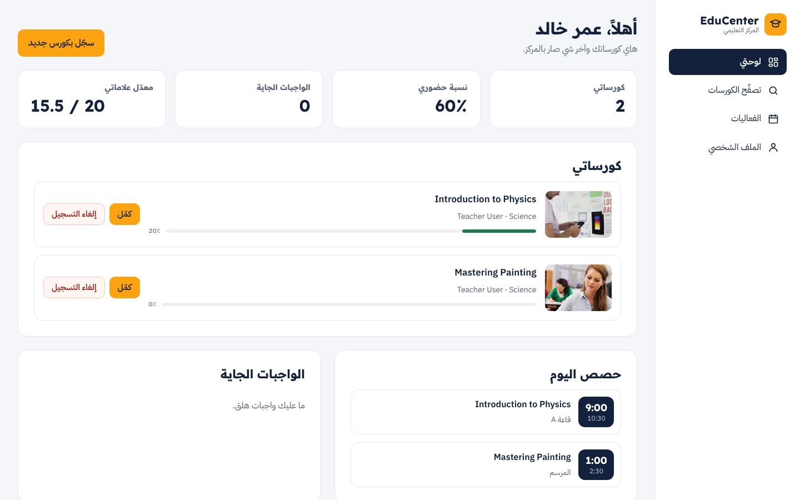 | 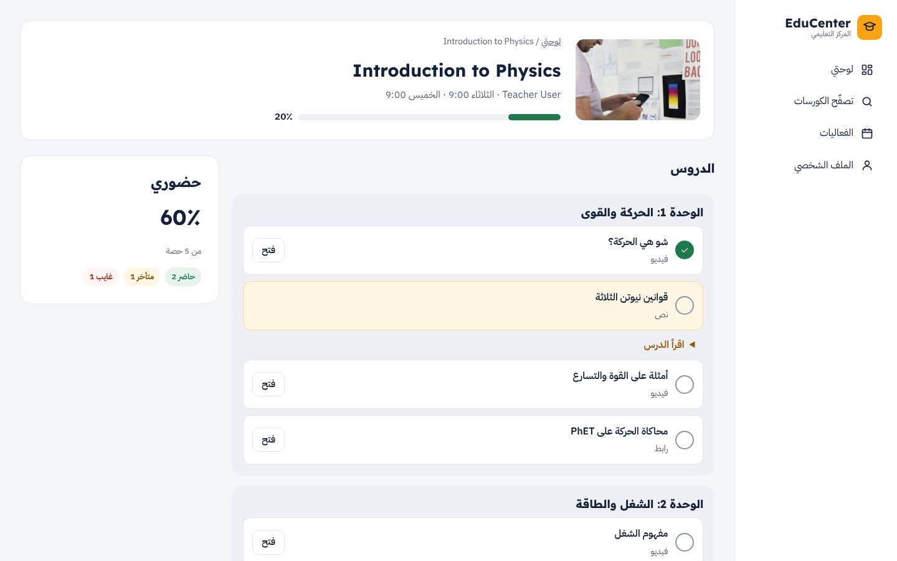 |
| 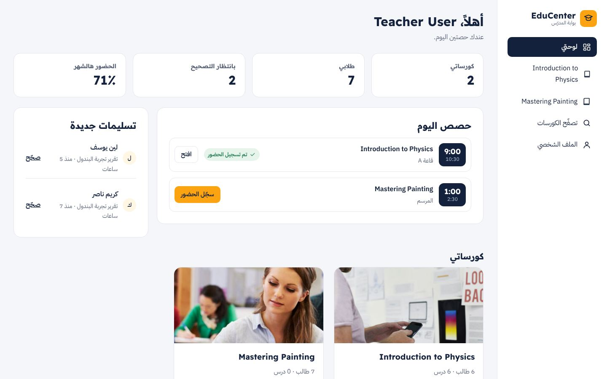 | 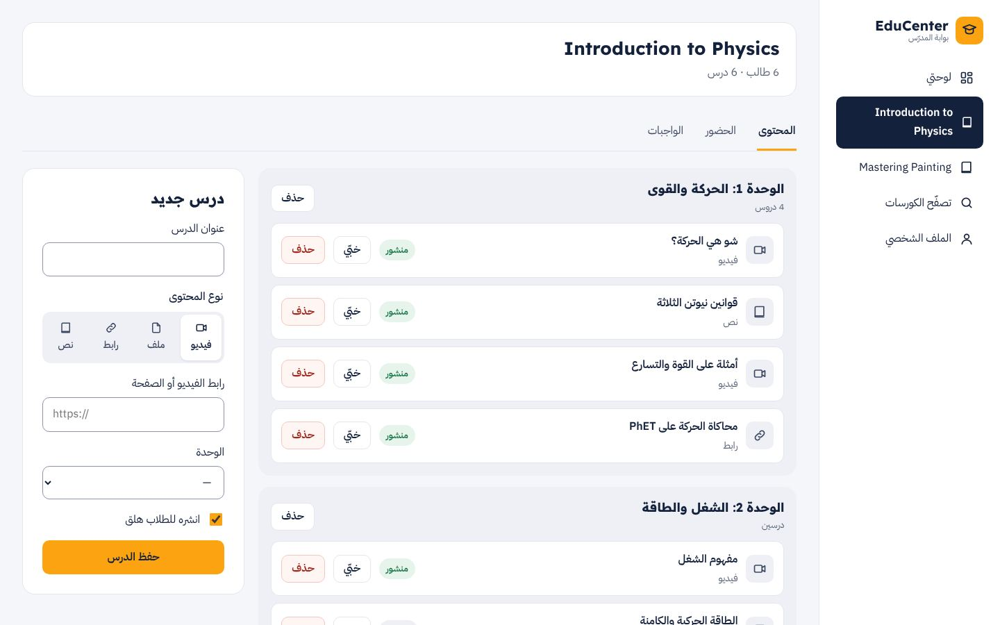 |
| 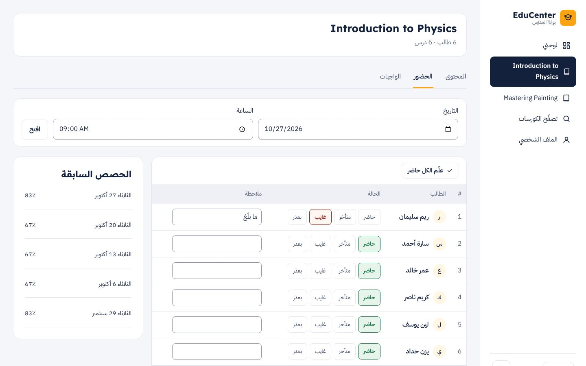 | 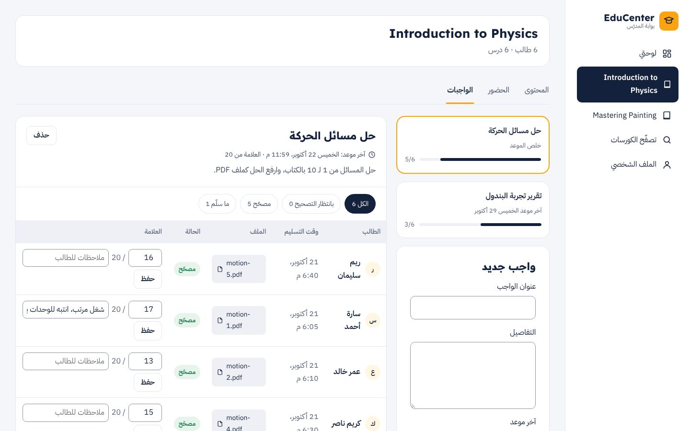 |
| 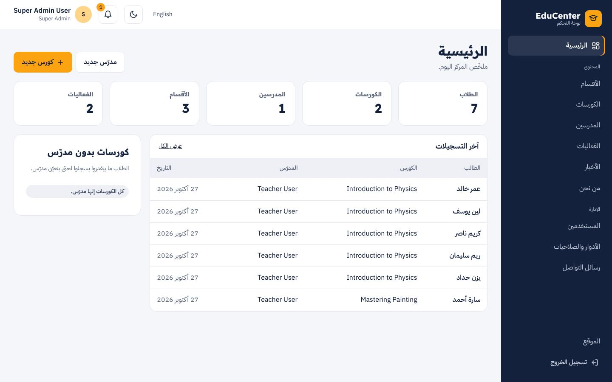 | 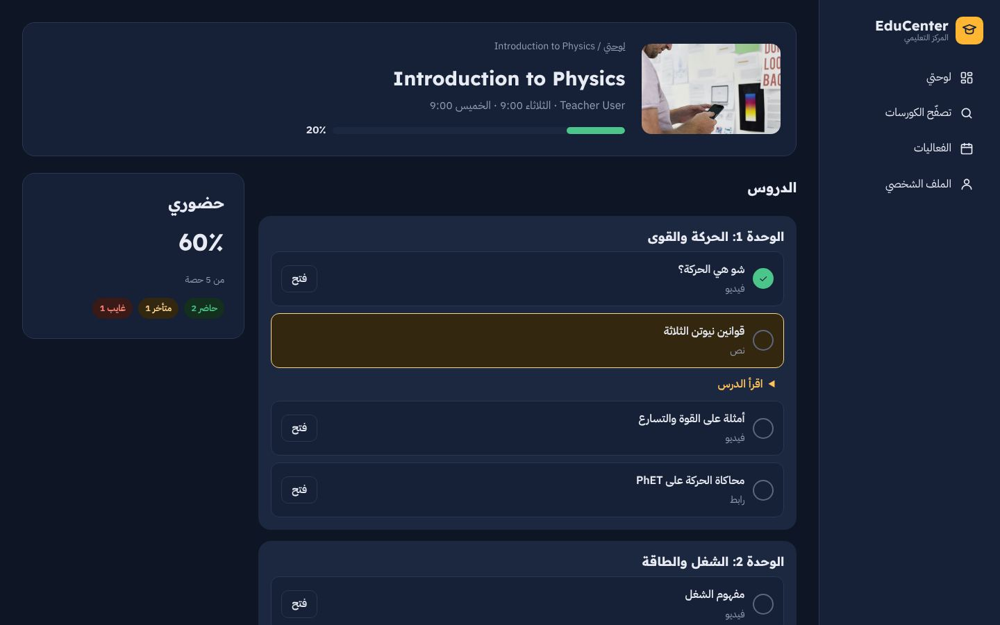 |
| 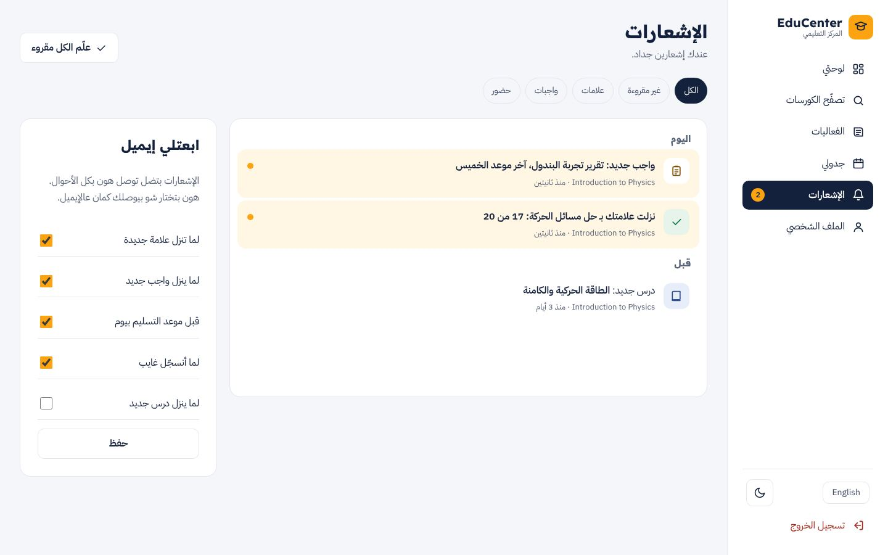 | 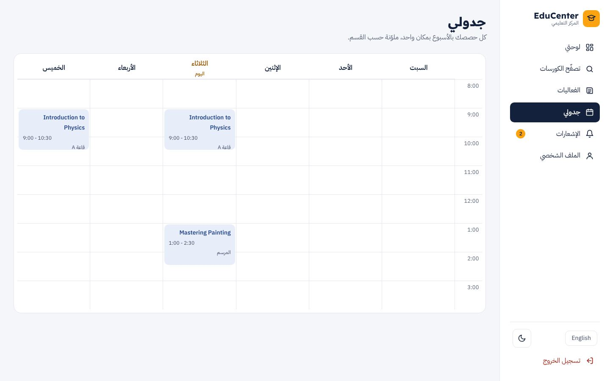 |
| 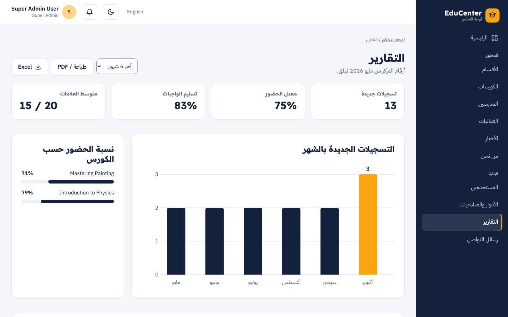 | 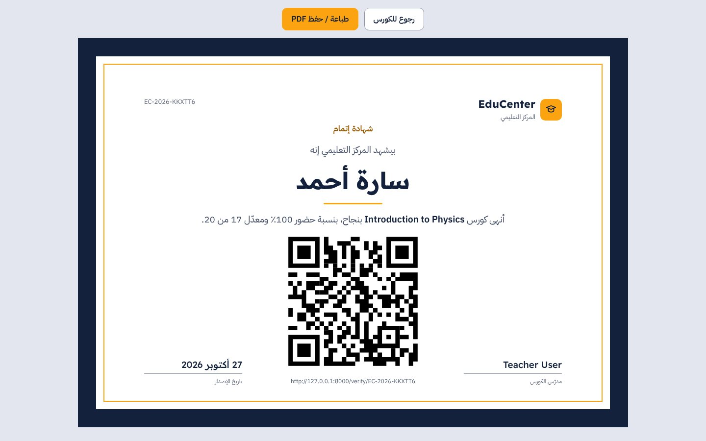 |
| 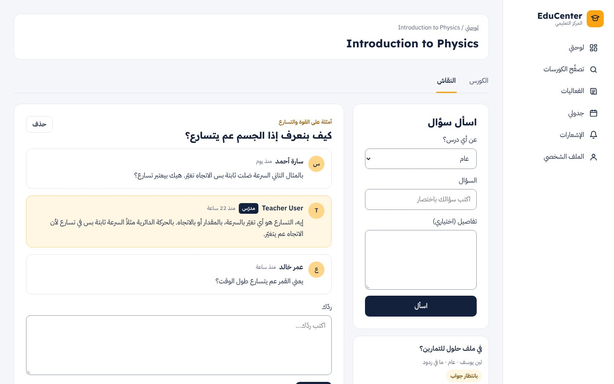 | 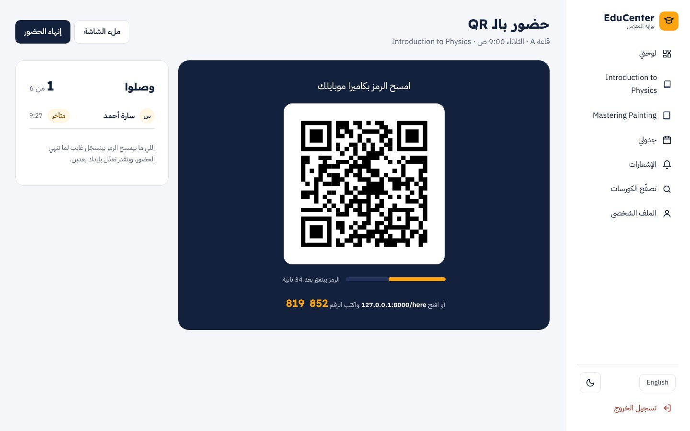 |
