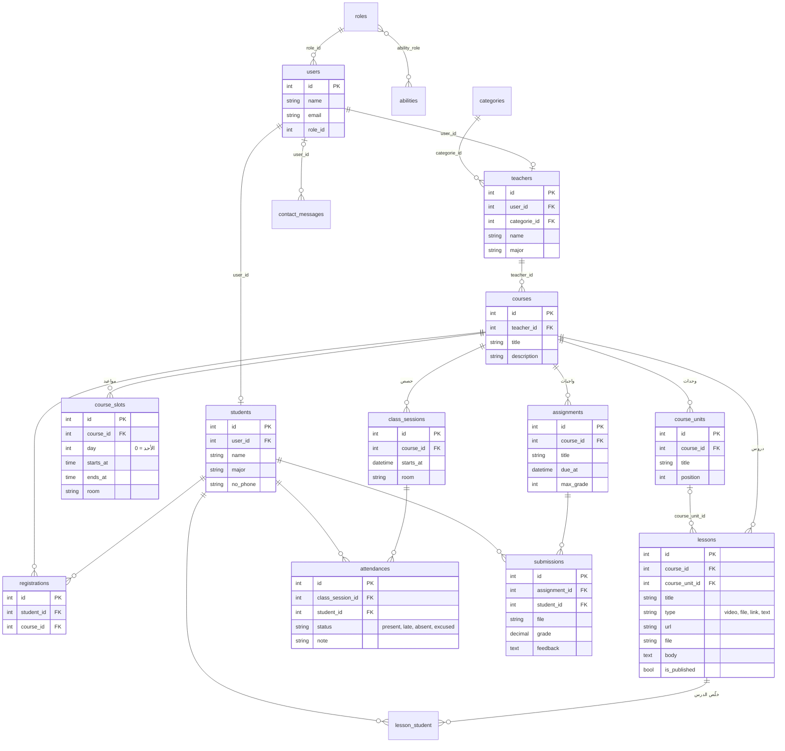

# قاعدة البيانات

المخطط تحت فيه الجداول الأساسية بس. جداول Laravel الجاهزة (`migrations`، `password_resets`، `failed_jobs`، `personal_access_tokens`، `notifications`) وجداول المحتوى العام (`events`، `news`، `abouts`) مش مرسومة لأنها ما إلها علاقات مع باقي الجداول.

## ملاحظات على التصميم

- **المستخدم والطالب والمدرّس:** كل واحد بيسجّل دخول من جدول `users`. الطالب إلو صف بجدول `students`، والمدرّس إلو صف بجدول `teachers`، والربط بينهم عن طريق `user_id`. كل الجداول الأكاديمية بتأشّر على `students.id`، مش على `users.id`.
- **التسجيل بكورس:** جدول `registrations` فيه بس الطالب والكورس، ومعهم قيد `unique` حتى ما يتسجّل الطالب مرتين. مدرّس الكورس بيتجاب من `courses.teacher_id`، فما في داعي نخزّنه مرة تانية.
- **الحضور:** كل حصة إلها صف بجدول `class_sessions`. أول ما المدرّس يحفظ الحضور بتنعمل الحصة، وبعدها كل طالب إلو صف بجدول `attendances`. على الجدول قيد `unique (class_session_id, student_id)`، يعني إذا حفظنا مرة تانية بيتعدّل الصف القديم وما بيتكرر.
- **الواجبات:** كل طالب إلو تسليم واحد لكل واجب، بقيد `unique (assignment_id, student_id)`. إذا رفع ملف جديد بيتبدّل القديم، إلا إذا الواجب انصحّح.
- **الملفات:** ملفات الدروس والتسليمات محفوظة بـ `storage/app`، مش بـ `public`. ما بتنزل إلا عن طريق الكنترولر، بعد ما نتأكد إنه الشخص مسجّل بالكورس أو إنه مدرّسه.
- **المواعيد والتعارض:** كل موعد أسبوعي للكورس إلو صف بجدول `course_slots` (اليوم، البداية، النهاية، القاعة). موعدين بيتعارضوا إذا كانوا بنفس اليوم، وبداية كل واحد قبل نهاية التاني. هيك منفحص قبل ما يتسجّل الطالب بكورس، وقبل ما المدرّس يضيف موعد.
- **الإشعارات:** محفوظة بجدول `notifications` الجاهز من Laravel. كل إشعار فيه نوعه، ومعلوماته، ورابط بيفتح الصفحة المناسبة. إعدادات الإيميل لكل مستخدم محفوظة بعمود `users.email_settings`. وعمود `assignments.reminded_at` بيمنع إنه التذكير ينبعت مرتين.
- **نسبة التقدّم:** هي عدد الدروس المنشورة اللي الطالب علّم عليها بجدول `lesson_student`، مقسوم على عدد كل الدروس المنشورة بالكورس.
